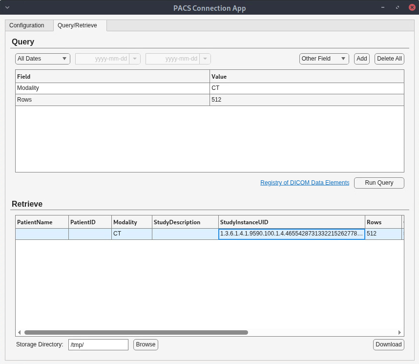

# PACS Connection App

The `PACSConnectionApp` is a MATLAB&reg; App Designer example that provides a simple, extensible UI for querying and retrieving DICOM data from a PACS server — without writing custom DICOM networking code, and without being locked into a fixed DICOM viewer's workflow. Because it is delivered as an App Designer example, imaging engineers and researchers can adapt the UI to their own workflows and embed it inside larger custom apps, such as the [Four Panel Medical Viewer App](https://github.com/MATLAB-Graphics-and-App-Building/Four-Panel-Medical-Viewer-App), so PACS import happens right next to the visualization or analysis code that consumes the data. It supports multiple persisted server configurations, secure (TLS) and non-secure connections, DICOM-attribute-based queries, an interactive results table, and download-to-disk or import-into-app modes.

## Features

* **Multiple server configurations** — Add, save, select, and delete PACS server configurations. Server settings persist across app instances during the MATLAB session using the `PACSConfigManager` custom class.
* **Secure and non-secure connections** — Establish standard DICOM connections or enable Transport Layer Security (TLS) with user-provided key, certificate, and trusted certificate files.
* **Flexible DICOM queries** — Query by date range, choose from commonly used DICOM attributes (for example, `PatientID`, `Modality`), or specify custom DICOM attributes with values to match.
* **Interactive results table** — View patient and study information for matching data sets returned by the PACS server, then select the series to retrieve.
* **Download or import** — Use the app in standalone mode to download DICOM data to a local storage directory, or embed it in your own app to import data directly into your workflow.

## Setup

### MathWorks Products (https://www.mathworks.com)

Requires MATLAB release R2026b or newer.

* [MATLAB&reg;](https://www.mathworks.com/products/matlab.html)
* [Medical Imaging Toolbox&trade;](https://www.mathworks.com/products/medical-imaging.html)

## Getting Started

Open `PACSConnectionApp.m` in App Designer or see the [guided walkthrough](https://www.mathworks.com/help/medical-imaging/ug/create-an-app-to-retrieve-dicom-data-from-pacs-server.html) on the documentation page.

## Repository Contents

| File | Description |
| ---- | ----------- |
| `PACSConnectionApp.m` | Main app implementing the tabbed **Configuration** and **Query/Retrieve** UI along with the DICOM connect, query, and retrieve workflow. |
| `PACSConfigManager.m` | Utility class that provides persistent storage of PACS server configurations across app instances during a MATLAB session. |
| `PACSConnectionApp.xml` | App component layout data |

## References

If you fork this repository to build your own MATLAB app, the following references are good starting points for structure, naming, and documentation consistency:

* [MATLAB Toolbox Best Practices](https://github.com/mathworks/toolboxdesign)
* [MATLAB Coding Guidelines](https://github.com/mathworks/MATLAB-Coding-Guidelines)

## License

The license is available in the `license.txt` file in this repository.

## Community Support

[MATLAB Central](https://www.mathworks.com/matlabcentral)

Copyright 2026 The MathWorks, Inc.
